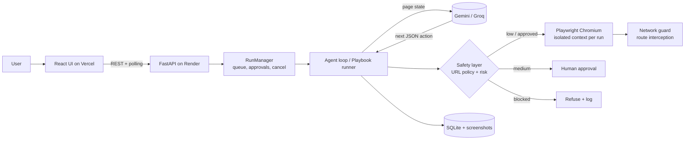

# TaskPilot: a safety-first browser agent

> Describe a low-risk, multi-step web task in plain English. TaskPilot drives a real headless browser to do it,
> shows every step with a screenshot, **pauses for your approval before anything state-changing**, and
> **hard-blocks payments, passwords and deletions**.

**Industry:** IT & Technology Services (web QA, SEO/accessibility auditing, link checking, research automation)
**Stack:** React (Vite) · FastAPI · Playwright (Chromium) · SQLite · Gemini / Groq free-tier LLMs · Docker
**Hosting (all free):** Vercel (UI) + Render (API + browser)

---

## 1. What it does

| Capability                            | How                                                                                                                                   |
| ------------------------------------- | ------------------------------------------------------------------------------------------------------------------------------------- |
| Natural-language **AI agent**         | Observe page → LLM picks one JSON action → safety check → execute → repeat (max-step + runtime limits, loop detection)                |
| **Playbooks** (no LLM, deterministic) | SEO & accessibility audit · broken-link checker · Hacker News top stories · Wikipedia summary · demo store search · demo contact form |
| **Three-tier risk model**             | Low → runs · Medium → human approval · Blocked → never runs                                                                           |
| **Human-in-the-loop approvals**       | Run pauses, UI shows exactly what will happen and why, auto-declines on timeout                                                       |
| **Live activity timeline**            | Every step with the model's reasoning, risk level, result and a screenshot                                                            |
| Results & export                      | Answer + structured data as tables / audit scorecard; export JSON or CSV                                                              |
| Run history, stop, delete             | Per-browser private history (anonymous client id)                                                                                     |
| Bring-your-own LLM key                | Pasted in Settings, kept in the browser, sent per run, never stored server-side                                                       |
| Abuse protection                      | Optional access code, per-IP rate limit, single-browser concurrency, auto-pruned history                                              |
| Built-in **Demo Store**               | A sandbox site exposing every risk level so the guardrails can be shown live and deterministically                                    |

## 2. Architecture



**Key design decisions**

1. **Safety runs outside the model.** `safety.py` classifies every action before it touches the browser; the LLM cannot override it. A blocked action is fed back to the model as `BLOCKED`, so it can pick another path or give up gracefully.
2. **Defence in depth on the network.** Besides checking navigation targets, Chromium's request routing validates _every_ sub-request (SSRF protection: private/loopback/link-local/metadata IPs, odd ports, credentials-in-URL, payment/banking/identity domains, optional per-task allowlist).
3. **Prompt-injection resistance.** Page text is wrapped as untrusted data and the model is told never to obey it; even if it did, the safety layer still blocks dangerous actions.
4. **Element ids, not selectors.** The page is converted into a numbered list of interactive elements (re-numbered every step), which is far more reliable for small free-tier models than CSS selectors.
5. **Secrets never persisted.** Text refused as sensitive (e.g. a card number) is stored as `[redacted]`; password values are never read.
6. **One fresh browser context per run**, destroyed afterwards: no cookies or state leak between runs or users.

### Risk rules (summary)

| Level             | Examples                                                                                                                                       |
| ----------------- | ---------------------------------------------------------------------------------------------------------------------------------------------- |
| Low (auto)        | open/scroll/back/read, click links, search boxes, normal fields, extract                                                                       |
| Medium (approval) | submit POST forms, send/post/publish, add to cart, sign up, subscribe, proceed to checkout                                                     |
| Blocked           | pay/buy/place order/donate/transfer/withdraw, delete/deactivate, password/card/CVV/OTP/ID fields, card-number-looking text (Luhn), login forms |

## 3. Project layout

```
backend/
  app/
    main.py        REST API, auth, rate limit, export, optional static UI hosting
    manager.py     run scheduling, approvals, cancellation, lifecycle
    agent.py       RunSession (validate→assess→approve→act→record), agent loop, playbook runner, prompts
    safety.py      URL policy, action risk assessment, validation
    browser.py     Playwright controller, DOM observation, network guard, extraction/audit/link-check actions
    llm.py         Gemini + Groq clients (JSON mode, retries, BYO key)
    playbooks.py   deterministic automations
    demo.py        built-in Demo Store (low / medium / blocked scenarios)
    db.py config.py
  tests/           71 tests: unit, end-to-end (real Chrome), UI (real Chrome driving the React app)
  Dockerfile
frontend/          Vite + React: New task, Run view, History, Safety, Settings
Dockerfile         optional single-container build (UI + API together)
render.yaml        Render blueprint
.github/workflows/ci.yml
```

## 4. Run it locally

```bash
# API
cd backend
python -m venv .venv
.\.venv\Scripts\Activate.ps1
pip install -r requirements-dev.txt
playwright install chromium
cp .env.example .env            # add GEMINI_API_KEY (free: https://aistudio.google.com/apikey) - optional, playbooks work without
uvicorn app.main:app --reload   # http://127.0.0.1:8000  (docs at /docs)

# UI (new terminal)
cd frontend
npm install
npm run dev                     # http://localhost:5173 (proxies /api and /demo to :8000)
```

`ALLOW_PRIVATE_HOSTS=true` in `.env` is needed locally so the agent can open the built-in demo store on `127.0.0.1`. **Never set it on a public server.**

### Tests

```bash
cd frontend && npm run build          # UI tests need the built app
cd ../backend && pytest -q            # 71 tests, ~40 s
```

The LLM is replaced by a scripted fake in tests (no network, no key needed); everything else is the real code path.

## 5. Deploy for free (Vercel + Render)

Free URLs: `https://<name>.vercel.app` and `https://<name>.onrender.com`. (A custom domain is optional and not needed.)

1. **Push to GitHub** (this folder as the repo root).
2. **Get a free LLM key**: Gemini at <https://aistudio.google.com/apikey> (or Groq at <https://console.groq.com/keys>).
3. **Backend on Render**: _New → Blueprint_ → select the repo (it reads `render.yaml`). Set `GEMINI_API_KEY`. Deploy, then copy the service URL.
   - Set `PUBLIC_BASE_URL` = that URL (used by the demo store) and redeploy.
4. **Frontend on Vercel**: _Add New → Project_ → same repo → **Root Directory: `frontend`** → add env `VITE_API_URL` = the Render URL (no trailing slash) → Deploy.
5. **Lock CORS**: in Render set `CORS_ORIGINS` = your Vercel URL, redeploy.
6. **Verify**: open the Vercel URL → _Playbooks_ → run "Demo store product search" → then try the AI agent example "Find a price".

Optional: set `ACCESS_CODE` in Render to keep strangers from using your LLM quota; users enter it in Settings.

### Free-tier realities (read before demo day)

- **Cold starts:** Render's free web service sleeps after ~15 min idle; the first request takes about a minute. Open the site 2 minutes before presenting. The UI shows a friendly retry message.
- **Memory:** the free plan has 512 MB RAM, which is tight for Chromium. `render.yaml` sets `BLOCK_HEAVY_RESOURCES=true` (images/fonts/media not loaded) and one concurrent run. If you still see crashes, deploy the **root `Dockerfile`** (UI + API in one container) to Hugging Face Spaces (Docker SDK), which gives far more RAM on its free CPU tier; set `PUBLIC_BASE_URL` to the Space URL and skip Vercel entirely.
- **Ephemeral disk:** history and screenshots are lost on restart/redeploy. Export results you need.
- **LLM limits:** free Gemini/Groq tiers are rate-limited and model names change; if a model is retired, set `GEMINI_MODEL` / `GROQ_MODEL` (or the Model field in Settings) to a current free one.

## 6. Configuration reference

See `backend/.env.example`. Most useful: `LLM_PROVIDER`, `GEMINI_API_KEY`/`GROQ_API_KEY`, `CORS_ORIGINS`, `PUBLIC_BASE_URL`, `ACCESS_CODE`, `RATE_LIMIT_PER_HOUR`, `MAX_STEPS`, `MAX_RUNTIME_S`, `APPROVAL_TIMEOUT_S`, `MAX_CONCURRENT_RUNS`, `BLOCK_HEAVY_RESOURCES`.

## 7. API (all under `/api`, header `X-Client-Id`, optional `X-Access-Code`)

| Method & path                               | Purpose                                                                                                                                            |
| ------------------------------------------- | -------------------------------------------------------------------------------------------------------------------------------------------------- |
| `GET /config`                               | feature flags, playbooks, blocked domains                                                                                                          |
| `POST /runs`                                | start a run: `{mode:"agent", goal, start_url?, allowed_domains?, max_steps?, require_approval?, llm?}` or `{mode:"playbook", playbook_id, params}` |
| `GET /runs`, `GET /runs/{id}`               | history / status, pending approval, result                                                                                                         |
| `GET /runs/{id}/steps?after=n`              | incremental step log (polled by the UI)                                                                                                            |
| `POST /runs/{id}/approve` `{approve}`       | answer a pending approval                                                                                                                          |
| `POST /runs/{id}/stop`, `DELETE /runs/{id}` | cancel / delete                                                                                                                                    |
| `GET /runs/{id}/export?format=json\|csv`    | download results                                                                                                                                   |

## 8. Suggested 5-minute demo script

1. **Playbook, no LLM:** _Website SEO audit_ on your own site → scorecard with concrete issues.
2. **AI agent, happy path:** example _Find a price_ → watch steps, screenshots, final answer.
3. **Human-in-the-loop:** example _Needs approval_ → run pauses at "Add to cart" → Approve/Decline.
4. **Guardrails:** example _Try to buy (blocked)_ → card entry and Pay are refused, agent reports back; open **Safety** page.
5. **Security story:** point to the network guard (SSRF), prompt-injection handling, redacted secrets, audit trail export.

## 9. Known limitations & future work

- Shadow DOM and cross-origin iframes are not observed; sites with heavy bot protection/CAPTCHAs are out of scope by design.
- DNS-rebinding between the safety check and Chromium's own lookup is a residual SSRF risk; mitigate in production with an egress firewall / proxy.
- The AI agent depends on free-tier model quality; vision input (sending the screenshot to the model) would improve reliability.
- Ideas: scheduled runs, saved/shareable playbooks built from successful agent runs, Postgres for durable history, per-user accounts (OAuth), webhook/Slack notifications, multi-tab plans.

## 10. Testing notes for the report

- 44 unit tests (URL policy incl. SSRF vectors, risk rules, Luhn, validation, LLM request shapes), 21 API/end-to-end tests with real Chromium (multi-step agent run, approvals approve/deny/auto, blocked actions, stop, step limit, isolation, export, rate limit, access code, SSRF in production mode), 6 UI tests driving the React app.
- Live Gemini/Groq calls are **not** part of the automated suite (they need your key and network); the request/response handling is unit-tested against the documented API shapes. Do a first manual run with your key before the demo.
